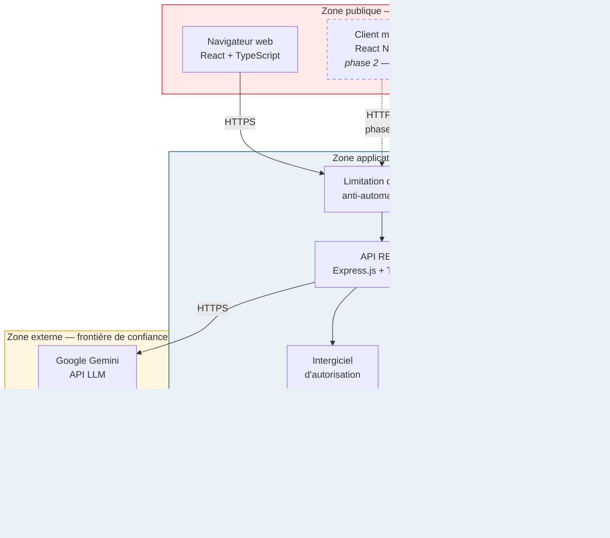
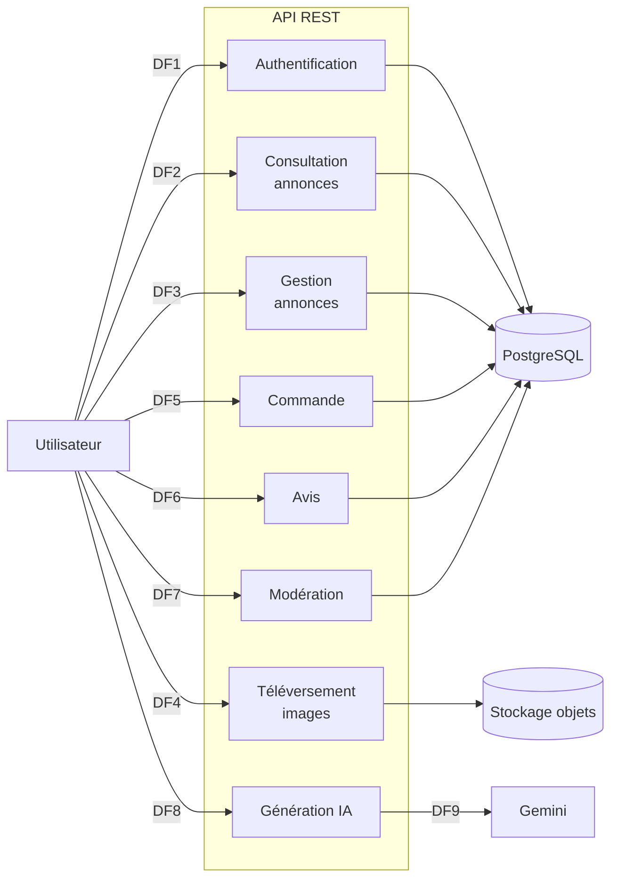
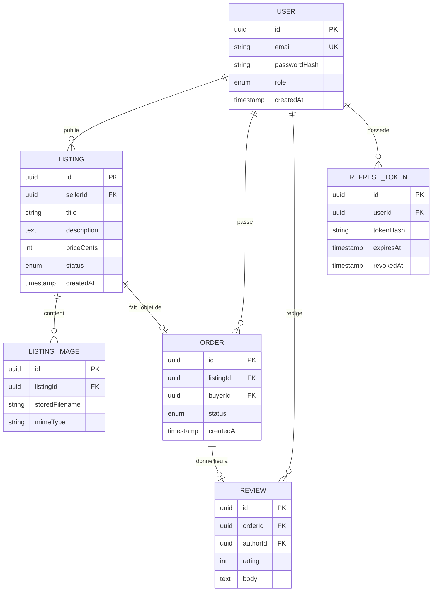

# Architecture de l'application

> **Phase 1 — Conception.** Document produit *avant* toute écriture de code
> applicatif, conformément à la stratégie exposée dans
> `docs/web-app-attack-plan.txt`.
>
> Pratiques concernées : **P7** Threat modelling (Tier 1),
> **P24** Security requirement gathering (Tier 2).

---

## 1. Vue d'ensemble des composants

### Frontières de confiance

| # | Frontière | Nature | Conséquence |
|---|---|---|---|
| TB1 | Client ↔ API | Tout ce qui vient du client est non fiable | Validation obligatoire en couche de service (`ASVS 2.2.2`) |
| TB2 | API ↔ Données | L'API est le seul point d'accès aux données | Autorisation résolue côté serveur (`ASVS 8.3.1`) |
| TB3 | API ↔ Gemini | Sortie hors de notre périmètre de contrôle | Aucun secret ni donnée personnelle transmis ; sortie traitée comme non fiable |
| TB4 | CI/CD ↔ Staging | Chaîne d'approvisionnement logicielle | Contrôles de sécurité obligatoires avant déploiement |

> **TB3 est la frontière la plus souvent négligée.** Le fournisseur LLM est un
> tiers : ce qui lui est envoyé quitte notre contrôle, et ce qu'il renvoie est
> une entrée non fiable au même titre qu'une saisie utilisateur.

---

## 2. Flux de données

### Inventaire des flux

| Id. | Flux | Acteur | Données en transit | Sensibilité |
|---|---|---|---|---|
| DF1 | Inscription / connexion | public | e-mail, mot de passe | **Élevée** |
| DF2 | Recherche et consultation | public | critères de recherche | Faible |
| DF3 | Création / modification / suppression d'annonce | vendeur | contenu d'annonce, prix | Moyenne |
| DF4 | Téléversement d'image | vendeur | fichier binaire non fiable | **Élevée** |
| DF5 | Passation de commande | acheteur | identifiant d'annonce, adresse | **Élevée** |
| DF6 | Dépôt d'avis | acheteur | texte libre | Moyenne |
| DF7 | Modération | administrateur | décisions de modération | **Élevée** |
| DF8 | Génération de description | vendeur | titre, catégorie, état | Moyenne |
| DF9 | Appel au LLM | API → tiers | invite construite | **Élevée** (sortie du périmètre) |

---

## 3. Acteurs et rôles

| Acteur | Authentifié | Peut | Ne peut pas |
|---|---|---|---|
| Visiteur | non | Consulter et rechercher les annonces | Créer, acheter, commenter |
| Acheteur | oui | Commander, consulter **ses** commandes, déposer un avis après achat | Modifier une annonce, voir les commandes d'autrui |
| Vendeur | oui | Créer et gérer **ses** annonces, téléverser des images sur **ses** annonces, utiliser la génération IA | Modifier une annonce d'autrui, modérer |
| Administrateur | oui | Modérer les annonces | — |

> La colonne **« ne peut pas »** est la plus importante du tableau : chaque
> interdiction qu'elle énonce devient un cas d'abus testé en phase 3.

---

## 4. Modèle de données

### Contrainte de conception déterminante

`LISTING.status` prend les valeurs `AVAILABLE`, `RESERVED`, `SOLD`,
`REMOVED`.

Cette énumération n'est pas un détail de modélisation : c'est le support du
contrôle de non-duplication de vente. Les articles vintage étant **uniques par
nature**, deux acheteurs ne doivent jamais pouvoir acquérir le même objet. Le
contrôle repose sur un verrouillage transactionnel de la ligne
(`SELECT ... FOR UPDATE`) lors du passage de commande (`ASVS 2.3.4`,
`ASVS 2.3.3`).

C'est la particularité de sécurité qui distingue cette place de marché d'un
commerce de biens en stock, et elle est testée en conditions concurrentes
réelles en phase 3.

---

## 5. Architecture indifférente au client

L'API est conçue pour servir indifféremment le front-end web et le futur client
mobile. Aucune logique métier, aucun contrôle d'autorisation et aucune
validation ne réside côté client.

Conséquence pour le report de l'application mobile :

| Réutilisé sans modification | Travaux propres au mobile |
|---|---|
| API et tous les contrôles serveur | Analyse OWASP Mobile Top 10 |
| Modèle de menaces (+ un flux client) | Stockage local sécurisé |
| Pipeline, gestion des secrets | Épinglage de certificat |
| Suite de tests d'abus (teste l'API) | SAST mobile (MobSF) |
| Exigences ASVS côté serveur | Signature et intégrité de l'artefact |

---

## 6. Hors périmètre

| Écarté | Motif |
|---|---|
| Paiement réel | N'ajoute aucune catégorie de risque non couverte ; le paiement simulé suffit à démontrer les abus de logique métier |
| Envoi de courriels | Idem ; ajouterait une dépendance externe sans bénéfice de démonstration |
| Authentification fédérée (OAuth/OIDC) | Permet d'exclure deux chapitres ASVS entiers (V10) de manière justifiée |
| Messagerie temps réel | Permet d'exclure le chapitre ASVS V17 (WebRTC) |

Ces exclusions sont **volontaires et justifiées**, et non des omissions. Elles
réduisent le périmètre ASVS à vérifier sans retirer aucune catégorie de risque
du projet.
